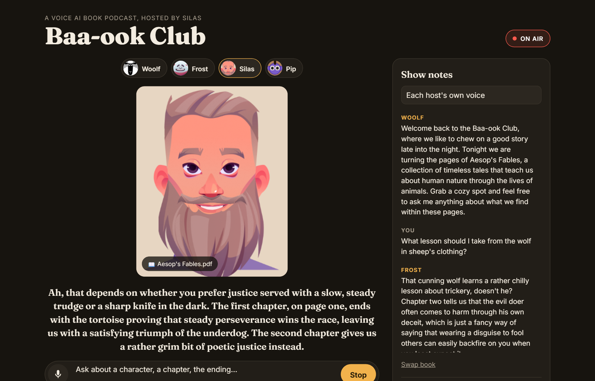

# Baa-ook Club

A voice AI book podcast. Upload a book as a PDF, pick a host, and ask questions out loud or by typing. The host answers
from the book in a deep podcast voice while an animated Rive character listens, thinks and talks.

Everything runs on Gemini's free tier. **Case study:** [shriy-singh.github.io/baa-ook-club](https://shriy-singh.github.io/baa-ook-club/)
covers the design decisions, latency measurements and how each character was rigged (source in [`case-study/`](case-study/)).

## Run it

1. Get a free Gemini API key at https://aistudio.google.com/apikey
2. Copy `.env.example` to `.env.local` and set `GEMINI_API_KEY=your-key`
3. `npm install`, then `npm run dev`
4. Open http://localhost:3210 in Chrome or Edge (the mic button uses their built-in speech recognition)

## The hosts

| Host | Personality | Voice | How the animation is driven |
|---|---|---|---|
| Woolf, a sheep | Calm, chews every chapter over | Charon | No inputs in the file; the chewing loop is scrubbed by voice loudness |
| Frost, a yeti | Big-hearted, encouraging | Algenib | `Talk` and `Hear` state machine switches, `success`/`fail` reactions |
| Silas, a storyteller | Fireside, a little dramatic | Gacrux | The `Talking` loop is scrubbed by loudness; eyebrows while talking |
| Pip, a pixel blob | Short and punchy | Orus | View model `mouthHeight`/`mouthWidth`; gaze steered with pointer events |

The app only tells a host what it's doing (`idle`, `listening`, `thinking`, `speaking`) and how loud the voice is.
A small driver per character in `components/Avatar.tsx` maps that onto whatever controls its `.riv` file has.

## How it works

| Piece | What it does |
|---|---|
| `lib/characters.ts` | Each host's persona, default voice, speaking style, crop and credit |
| `components/Avatar.tsx` | Loads a host's `.riv`, crops it to the stage, and runs its driver every frame |
| `app/api/upload` | Sends the PDF to the Gemini Files API (kept 48 hours, up to 1,000 pages) |
| `app/api/ask` | `gemini-3.5-flash-lite` answers as the chosen host; follow-ups chain via `previous_interaction_id` |
| `app/api/speak` | `gemini-3.8-flash-lite-tts` voices the answer; the first sentence is voiced separately so speech starts sooner |
| Browser speech recognition | Turns a spoken question into text, free, in Chrome and Edge |

Change the models in `.env.local` (`GEMINI_MODEL`, `GEMINI_TTS_MODEL`). `gemini-3.8-flash-tts` sounds richer but is
about 2.5 seconds slower per answer.

### Adding a host

1. Put the `.riv` file in `public/characters/` and a 96×96 face thumbnail next to it as `<id>.png`.
2. Add an entry to `CHARACTERS` in `lib/characters.ts`.
3. Add a driver to `DRIVERS` in `components/Avatar.tsx` that maps the four states onto the file's animations, inputs or view model.

## Deploying

It runs on Vercel as is. Add `GEMINI_API_KEY` in the project settings. Vercel caps uploads to API routes at about
4.5 MB, so bigger PDFs only work locally unless uploads go straight from the browser to Gemini.

## Credits

The characters are Rive community files, each under [CC BY 4.0](https://creativecommons.org/licenses/by/4.0/).
Names, personalities and voices were added for this project; the artwork and animation are the artists' own.

- Woolf: [Kuzu Kuzu Mee](https://rive.app/community/files/28304-53466-kuzu-kuzu-mee/) by musaadanur
- Frost: [Wave, Hear and talk](https://rive.app/community/files/5628-11215-wave-hear-and-talk/) by japarj, a remix of JcToon's Login Screen Character
- Silas: [Character face animation](https://rive.app/community/files/4532-9211-character-face-animation/) by ak2665622
- Pip: [Rive Avatar](https://rive.app/marketplace/28249-53356-rive-avatar/) by nasmith

A personal project, not affiliated with Google, Rive or the artists above.
